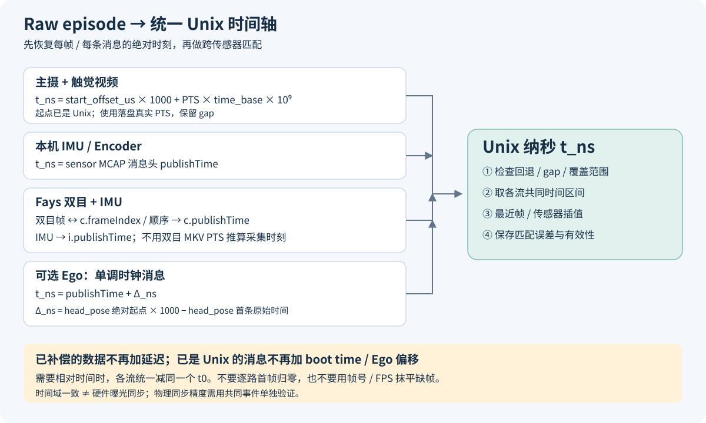

# Raw episode：各传感器如何对齐到 Unix

适用：当前 UGripper episode（metadata `data_version=3.2`）。历史数据先确认字段语义；不要只按文件名套用。目标是为每帧/每条消息得到统一的 **Unix 纳秒 `t_ns`**，再按时间匹配。



## 1. 各路时间怎么取

| 数据 | 使用的时间 | 换算为 Unix 纳秒 |
| --- | --- | --- |
| 主摄 `cam_left/right.mkv`、可选 `cam_chest.mkv` | 本路 metadata 的 `video_details[].start_offset_us` + 该帧视频 PTS | `t_ns = start_offset_us × 1000 + PTS × time_base × 10⁹` |
| 触觉 `tcam_*.mkv` | 同上 | 同上 |
| 本机 `sensor_left/right.mcap` 的 IMU、encoder 等实际存在 topic | MCAP 消息头 `publishTime` | `t_ns = publishTime`，已经是 Unix 纳秒 |
| 双目 `stereo_left/right.mkv` | 同侧 `fays_data_*.mcap` 的 `c` topic，与视频按 `frameIndex` / 写入顺序对应 | `t_ns = c.publishTime`，已经是补偿后的 Unix 纳秒 |
| Fays IMU | 同侧 `fays_data_*.mcap` 的 `i` topic | `t_ns = i.publishTime`，已经是 Unix 纳秒 |
| 可选 Ego `ego/sensor.mcap` 的单调时钟 topic（`head_pose/controller_pose/imu`） | 使用下述 head_pose 锚点 | `t_ns = publishTime + Δ_ns` |
| Ego 已是 Unix 的 topic（如 `*_metainfo`） | 消息头 `publishTime` | 直接使用，不加 `Δ_ns` |

`publishTime` 是 MCAP 消息头字段（Python reader 常命名为 `publish_time`），不是 payload 内任意一个同名时间字段。`PTS` 为整数 tick，`time_base` 为视频流的有理数时间基；若读的是 `pts_time` 秒值，只需乘 `10⁹`，不要再乘 time_base。计算建议用整数/有理数，避免大 Unix 数值的浮点精度损失。

**Ego 锚点：** 令 `A_us = ego/metadata.json.head_pose_details[name=head_pose].start_offset_us`，`H0_ns` 为 head_pose 首条有效消息的原始 `publishTime`：

```text
Δ_ns = A_us × 1000 − H0_ns
Ego 单调时钟消息 t_ns = publishTime + Δ_ns
```

只对与 head_pose 共用该单调时钟域的消息应用此偏移；锚点缺失时标记无法可靠换算。Ego 自带视频需按其自身 metadata/格式契约单独解析，不能套用 UGripper 根目录的视频起点。

## 2. 后处理顺序

1. 读取最终 `metadata.json`，按 `video_details[].name` 匹配对应视频；按实际录制 profile 选择流（`+nostereo` 无 Fays/双目）。
2. 逐帧读取真实 PTS、逐条读取 MCAP，按上表转换，保留原始索引和时间。双目同时核对视频帧数、`c` 消息数及索引连续性，异常时不要直接按数组下标强行配对。
3. 先检查各流时间回退、重复、大 gap 和首末覆盖，再取共同区间：`[max(各流首时刻), min(各流末时刻)]`。若左端大于右端，则没有共同区间。
4. 在共同区间选主摄帧时刻或固定采样网格；图像取最近帧并限制时间差，连续传感器量按需插值（姿态用四元数 SLERP）。阈值根据各流频率和业务精度制定；缺帧、长 gap 不跨越插值，输出有效性标记及匹配误差。
5. 如需 episode 相对时间，最后统一减同一个 `t0_ns`：`t_rel_s = (t_ns − t0_ns) / 10⁹`，不要把每路各自首帧都归零。

例如：视频起点 `1780000000000000 us`、某帧 PTS 为 `0.040 s`，其 Unix 时间为 `1780000000040000000 ns`。若某条 IMU 为 `1780000000041000000 ns`，则 IMU 比该帧晚 **1 ms**。

## 3. 最容易错的地方

- **双目不能用 `start_offset_us + MKV PTS` 重建采集时间。** MKV 是固定帧率播放轴，会压紧设备 gap；真实逐帧时间取 `c.publishTime`。Fays 的 `logTime` 是原始设备时间，只用于设备侧 gap/回退分析。
- **不要重复加 boot time 或延迟补偿。** 当前 `start_offset_us` 是绝对 Unix 微秒，不是相对 episode 偏移；相机固定补偿已写入视频起点或 Fays camera `publishTime`。`boot_time_s` 不是所有流都要加的通用偏移。
- **主摄以落盘 PTS 为准，不用帧号 / FPS，也不直接以 SEI 覆盖 PTS。** 当前 H.264/H.265 录制端已完成 XU/SEI 的 Unix 映射；落盘 PTS 还可能包含插补帧时刻修正和单调保护。
- **统一时间域不等于曝光硬同步。** 触觉时间仍含采集链路误差，Ego 固定偏移也不消除长期漂移；需要物理同步精度时，用毫秒表/共同事件验证。首帧差主要体现启动错峰。

依据：[当前产物与时间语义](agent/overview.md#7-episode-产物与检查)、[离线校验器](../.codex/skills/validate-episode-data/scripts/validate_episode.py)、[本机 MCAP 写入](../standalone/SensorRecorder/main.cc)、[Fays MCAP 写入](../standalone/FaysStereoRecorder/src/record.cpp)。
